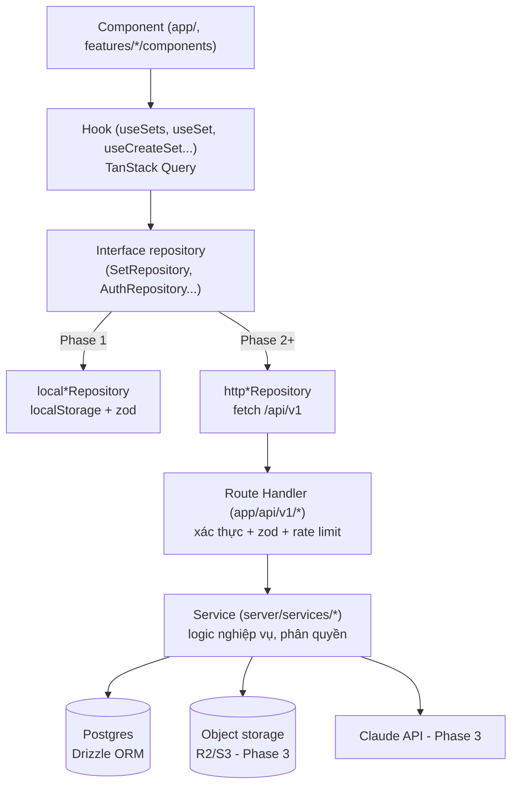

# Kiến trúc SiroQuizz

## Tổng quan theo lớp



- **Component** chỉ hiển thị và gọi hook. Component không import repository hay `fetch` trực tiếp.
- **Hook** quản lý cache, loading, error, optimistic update và rollback qua TanStack Query.
- **Repository** là ranh giới đổi nguồn dữ liệu. `DataProvider` (`src/lib/data-provider.tsx`) chọn cài đặt local hoặc http dựa vào biến môi trường `NEXT_PUBLIC_DATA_SOURCE`.
- **Service (server)** kiểm tra quyền sở hữu, ghi vào DB và gọi dịch vụ ngoài. Route Handler chỉ làm 3 việc: xác thực, validate rồi gọi service.

## Cấu trúc thư mục

```
src/
  app/
    (marketing)/          landing, trang công khai (Phase 5: /explore, /s/[slug], /u/[username])
    (auth)/               login, register, forgot-password, reset-password (P2), verify-email (P2)
    (app)/                home, library, sets/*, settings, stats (P4), folders (P5), classes (P5)
    (study)/              study/[id]/flashcards|learn (P4)|test|games/*
    api/v1/               Route Handler (từ Phase 2)
  components/ui/          primitive giao diện dùng chung
  components/layout/      header, sidebar, study top bar, language switcher, theme toggle
  features/<domain>/      components/, hooks.ts, repository.ts, schemas.ts, lib/ (logic thuần)
  lib/                    types, storage, id, shuffle, normalize, speech, cn, data-provider
  server/                 (Phase 2+) db/, services/, auth.ts, rate-limit.ts, env.ts — chỉ import từ server
  i18n/                   config.ts, request.ts
messages/                 vi.json, en.json, zh.json
specs/                    tài liệu kế hoạch (thư mục này)
tests/e2e/                Playwright
```

**Quy tắc import.**

- `features/*` không import chéo vào phần nội bộ của nhau. Phần dùng chung đặt ở `lib/` hoặc `components/`.
- `server/*` có `import "server-only"`.
- Logic trong `features/*/lib` không phụ thuộc React.

## Mô hình dữ liệu qua các phase

```mermaid
erDiagram
  USER ||--o{ STUDY_SET : owns
  STUDY_SET ||--o{ CARD : contains
  USER ||--o{ CARD_PROGRESS : tracks
  CARD ||--o{ CARD_PROGRESS : "has"
  USER ||--o{ TEST_RESULT : takes
  USER ||--o{ GAME_SCORE : plays
  USER ||--o{ AI_GENERATION_JOB : "requests (P3)"
  USER ||--o{ STUDY_SESSION : "logs (P4)"
  USER ||--o{ FOLDER : "organizes (P5)"
  CLASS ||--o{ CLASS_MEMBER : "has (P5)"
  CLASS ||--o{ CLASS_SET : "assigns (P5)"
```

| Thực thể                                               | Phase                      | Ghi chú                                                                                                                                    |
| ------------------------------------------------------ | -------------------------- | ------------------------------------------------------------------------------------------------------------------------------------------ |
| `User`                                                 | 1 (mock) → 2 (Better Auth) | `displayName`, `avatarColor`, `uiLocale`. Từ P2 thêm `emailVerified`, `image`, `username` (P5)                                             |
| `StudySet`                                             | 1                          | `title`, `description`, `termLang`, `definitionLang`, `source` (`manual`/`ai`/`import`). P5 thêm `visibility`, `slug`, `copiedFromId`      |
| `Card`                                                 | 1                          | `term`, `definition`, `phonetic?`. P2 thêm `position`. P4 thêm `imageUrl?`, `starred` (theo người dùng, nằm ở progress)                    |
| `CardProgress`                                         | 1                          | P1 lưu `status` (`new`/`learning`/`known`). P4 thêm trường FSRS: `due`, `stability`, `difficulty`, `reps`, `lapses`, `state`, `lastReview` |
| `TestResult`, `GameScore`                              | 1                          | P5 dùng `GameScore` làm bảng xếp hạng                                                                                                      |
| `AiGenerationJob`                                      | 3                          | trạng thái job, file, prompt, token, chi phí, lỗi                                                                                          |
| `StudySession`                                         | 4                          | thời lượng, chế độ, số thẻ, dùng cho streak và thống kê                                                                                    |
| `Folder`, `Class`, `ClassMember`, `ClassSet`, `Report` | 5                          | tổ chức nội dung, lớp học, kiểm duyệt                                                                                                      |

ID: Phase 1 dùng UUID v4 (`crypto.randomUUID()`, tạo ở client). Từ Phase 2, server sinh UUID v7 (sắp xếp được theo thời gian); hai loại cùng định dạng chuỗi UUID nên không cần chuyển đổi dữ liệu cũ. Thời gian lưu dạng ISO 8601 UTC.

## Quy ước API (từ Phase 2)

- Tiền tố `/api/v1`, dùng danh từ số nhiều: `/sets`, `/sets/:id/cards`, `/sets/:id/progress`.
- Envelope thống nhất:
  ```ts
  type ApiResponse<T> =
    | {
        success: true;
        data: T;
        meta?: { total?: number; limit?: number; nextCursor?: string | null };
      }
    | { success: false; error: { code: string; message: string; fields?: Record<string, string> } };
  ```
- Mã lỗi:
  - `VALIDATION_ERROR` (400), `UNAUTHENTICATED` (401), `FORBIDDEN` (403), `NOT_FOUND` (404), `CONFLICT` (409), `RATE_LIMITED` (429), `INTERNAL` (500).
  - Khi người dùng không có quyền với tài nguyên riêng tư thì trả 404, không trả 403, để không lộ việc tài nguyên đó tồn tại.
- Phân trang theo cursor (`?cursor=&limit=`, tối đa 50) cho danh sách. Mọi truy vấn danh sách đều có `LIMIT`.
- Repository HTTP gom các trang để giữ interface `findAll()` / lịch sử của Phase 1. `meta.nextCursor` là `null` (hoặc không có) ở trang cuối; client chặn cursor lặp và báo lỗi khi vượt giới hạn trang, không âm thầm trả danh sách thiếu.
- `message` trong lỗi là key i18n (vd. `errors.set.notFound`), client tự dịch.

## Đa ngôn ngữ

- Có 2 khái niệm ngôn ngữ khác nhau: **ngôn ngữ giao diện** (`vi`/`en`/`zh`, qua next-intl) và **ngôn ngữ nội dung thẻ** (`termLang`/`definitionLang`, dùng cho phát âm, phiên âm và AI).
- Phase 1–5 lưu locale trong cookie `NEXT_LOCALE`, không có tiền tố URL. Phase 6 thêm tiền tố locale cho các trang công khai (`/en/s/...`) để làm SEO, còn trang trong app vẫn dùng cookie.
- Ngày, số và thời lượng định dạng bằng `Intl` thông qua `useFormatter` của next-intl.

## Chiến lược kiểm thử

| Tầng              | Công cụ                         | Phạm vi                                                                 |
| ----------------- | ------------------------------- | ----------------------------------------------------------------------- |
| Unit              | Vitest                          | logic thuần (tạo đề, chấm, game, FSRS, parse), schema, repository local |
| Component         | Vitest + Testing Library        | component có tương tác: form, thẻ lật, câu hỏi                          |
| Integration (P2+) | Vitest + Postgres test (Docker) | service và Route Handler: phân quyền, validate, rate limit              |
| AI eval (P3)      | script eval riêng               | chất lượng thẻ AI trên bộ tài liệu chuẩn                                |
| E2E               | Playwright                      | luồng chính của mỗi phase, chạy trên Chromium, Firefox và WebKit        |
| Visual            | Playwright screenshot           | landing, flashcard, test, game ở 320/768/1024/1440, light/dark          |

## Bảo mật nền

- Validate bằng zod ở mọi biên: form, localStorage, request API, output của AI.
- Không render HTML do người dùng nhập (`dangerouslySetInnerHTML` bị cấm). Nội dung thẻ chỉ hiển thị dạng text. Nếu P4 có định dạng chữ thì dùng markdown giới hạn và sanitize.
- Secret chỉ nằm trong biến môi trường phía server, được validate khi khởi động (`server/env.ts`).
- Cookie phiên đặt `HttpOnly`, `Secure`, `SameSite=Lax`. API ghi dữ liệu kiểm tra header `Origin`.
- Rate limit cho auth, các endpoint ghi, upload và AI.
- Header bảo mật và CSP nonce được thêm hoàn chỉnh ở Phase 6, nhưng không dùng inline script ngay từ Phase 1.
